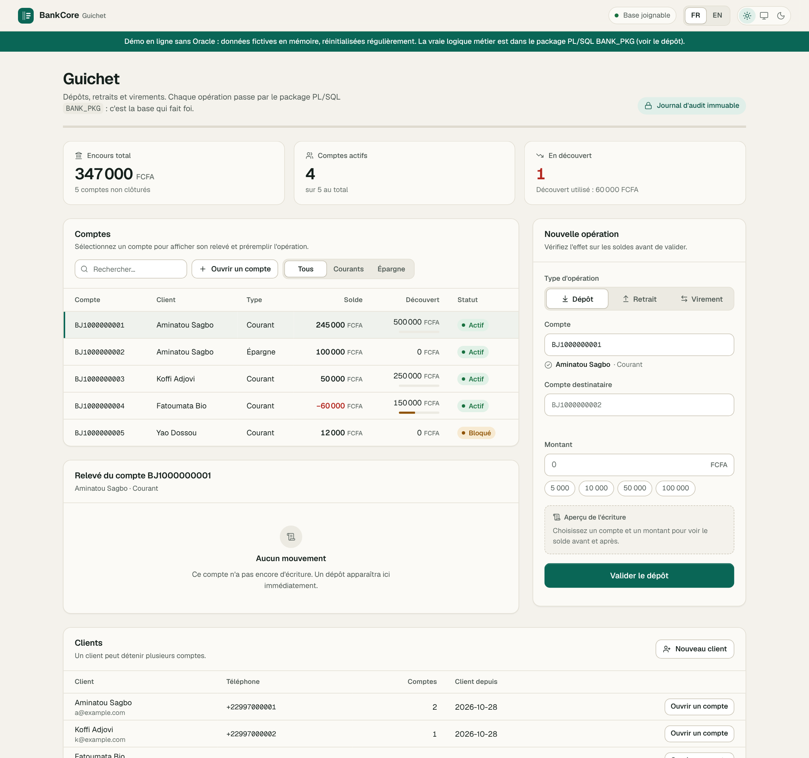
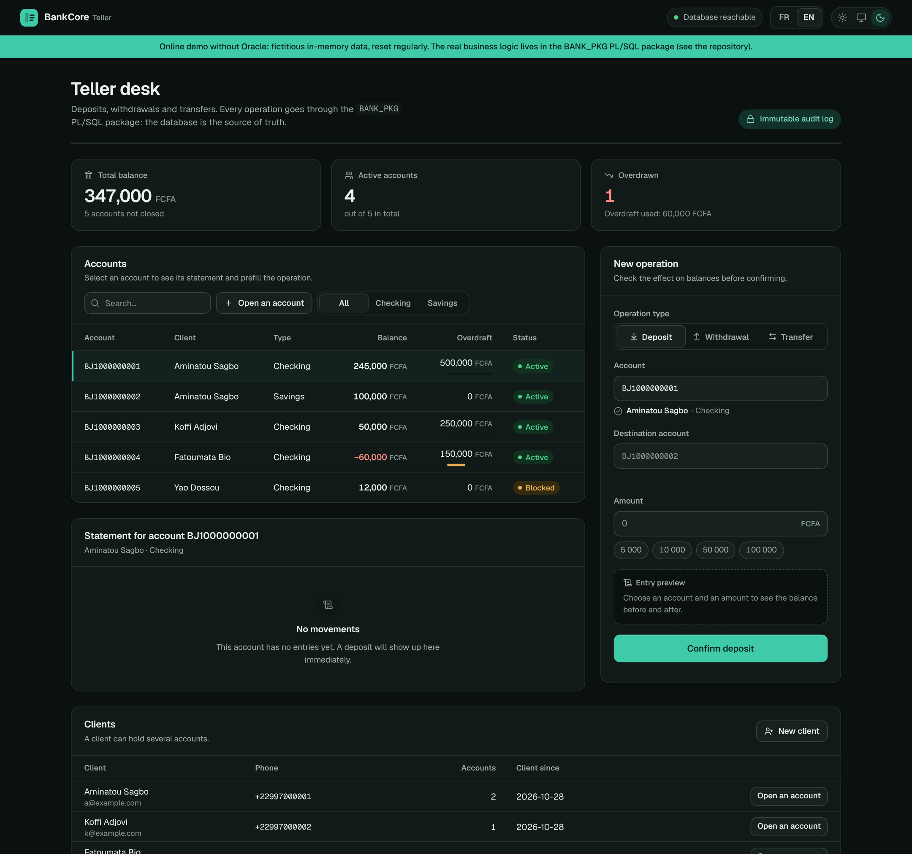
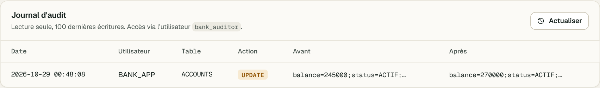
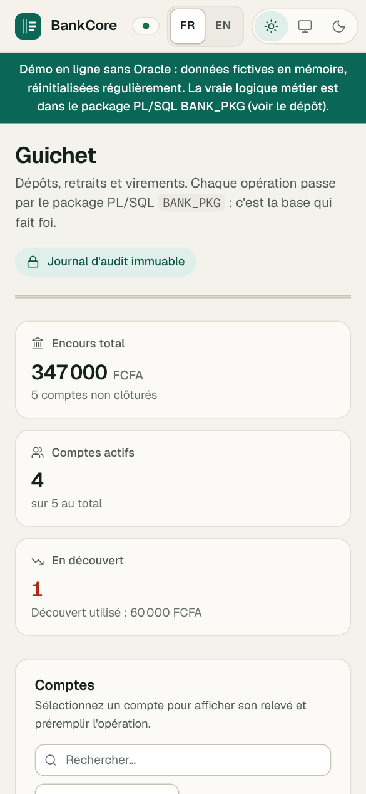

# BankCore — Oracle & PL/SQL administration of a banking module

🇫🇷 [Français](README.md) · 🇬🇧 **English**

[](../../actions/workflows/ci.yml)


A banking module built **around the database**: business rules, security, auditing and backups all live in **Oracle**. A small **Python (Flask) API** calls the PL/SQL package, and a **web teller interface** sits on top of that API. Every refusal (insufficient funds, blocked account…) comes from the database, not from application code.

<!-- Online demo: add the link here once the project is deployed on Render -->

| Teller desk (light theme, French) | Teller desk (dark theme, English) |
|---|---|
|  |  |

| Audit log | Mobile (390 px) |
|---|---|
|  |  |

_Screenshots taken with the demo server (`dev_mock.py`, fictitious data)._

## What the project demonstrates

- **Relational modelling**: keys, `CHECK` constraints (for example `balance >= -overdraft_limit`), indexes, comments (`sql/02_schema.sql`).
- **Advanced PL/SQL**: `BANK_PKG` package, business exceptions `ORA-20001` to `20006`, `SELECT … FOR UPDATE`, deadlock-free lock ordering for transfers, `SYS_REFCURSOR` (`sql/03_pkg_bank.sql`).
- **Triggers**: automatic balance auditing, immutable accounting ledger, account deletion forbidden, email normalization (`sql/04_triggers.sql`).
- **Security and privileges**: `ROLE_TELLER` and `ROLE_AUDITOR` roles, least privilege, lockout profile after 5 failed logins (`sql/01_users.sql`, `sql/05_views_grants.sql`).
- **Backup and restore**: Data Pump (`expdp` / `impdp`) in PowerShell and Bash, with tests rerun after a restore.
- **Clean integration**: a REST API that only calls the package, never the tables; errors returned with a stable code, translated by the interface.
- **Polished interface**: HTML/CSS/JS with no framework or build step, bilingual FR / EN, light/dark theme, responsive (390 → 1440 px), keyboard navigation, bundled fonts.
- **Tests**: 11 SQL checks on the database, 36 `pytest` tests without Oracle, run automatically by GitHub Actions.

## Architecture

```
Browser ──► Flask (api/app.py) ──► Oracle XE (Docker container)
              │                      ├─ BANK_OWNER : tables, package, triggers, views
              ├─ BANK_APP     ─────► ├─ ROLE_TELLER  : EXECUTE bank_pkg + SELECT v_account_summary, v_client_summary
              └─ BANK_AUDITOR ─────► └─ ROLE_AUDITOR : SELECT only (views, audit, transactions)
```

The application user `BANK_APP` has **no direct access to the tables**: it can only call the package procedures, and therefore must follow the business rules.

```
bankcore/
├── sql/             schema, package, triggers, views and grants, seed data, tests
├── scripts/         setup, backup, restore, API launcher (PowerShell and Bash)
├── api/
│   ├── app.py       Flask API (connected to Oracle)
│   ├── dev_mock.py  demo server without Oracle
│   ├── tests/       pytest tests (API with a simulated pool, demo server)
│   └── static/      interface (index.html, css/, js/ including i18n.js, fonts/)
├── design/          interface design notes (audit, direction, tokens, screens; in French)
├── docs/            README screenshots
├── .github/         continuous integration
├── Dockerfile       image of the online demo (no Oracle)
├── docker-compose.yml, .devcontainer/, .env.example
└── LICENSE
```

## Technical choices

- **Why everything in the database**: a rule written in the package applies whatever the client (API, SQL script, another application). `CHECK` constraints and triggers guarantee it even if application code gets it wrong.
- **Why a package and no rights on the tables**: `BANK_APP` cannot bypass the rules. A compromised teller account can neither edit a balance by hand nor delete an entry.
- **Why lock accounts in account-number order**: two crossing transfers (A→B and B→A) would take locks in opposite orders and block each other. A deterministic order removes that case.
- **Why an immutable transaction ledger and trigger-based auditing**: history can be neither rewritten nor forgotten by the application; every change of balance, status or overdraft is traced with the user, IP address and date.
- **Why a thin API and no front-end framework**: the interface boils down to tables and a few forms. HTML/CSS/JS is enough, with no build step, and everything is served by the same Flask application.
- **Why stable error codes**: `{"error": "…", "code": "insufficient_funds"}` keeps a human-readable message (French, as raised by the package) and a language-independent code that the interface translates into French or English.

## How the database works

### Data model

`CLIENTS` 1—n `ACCOUNTS` 1—n `TRANSACTIONS`, plus `AUDIT_LOG` (filled by trigger only). The `CHECK (balance >= -overdraft_limit)` constraint guarantees in the database that a balance never goes beyond the authorised overdraft.

### `BANK_PKG` package

| Subprogram | Purpose |
|---|---|
| `create_client` | Creates a client (unique, normalized email) |
| `open_account` | Opens a checking account (with overdraft) or a savings account (never any overdraft), optional initial deposit |
| `deposit`, `withdraw` | Movements with row locking and balance check |
| `transfer` | Atomic transfer; locks taken in account-number order (no deadlock) |
| `get_balance`, `statement` | Queries (the statement returns a `SYS_REFCURSOR`) |

Business errors: `ORA-20001` insufficient funds · `20002` account not active · `20003` invalid amount · `20004` account not found · `20005` same account · `20006` email already used.

### Triggers

- `trg_accounts_audit`: every change of balance, status or overdraft is written to `AUDIT_LOG` (old/new value, user, IP, date).
- `trg_transactions_immutable`: no transaction can be updated or deleted.
- `trg_accounts_no_delete`: an account is closed (`status = 'CLOTURE'`), never deleted.
- `trg_clients_normalize`: email lowercased and trimmed.

### Users and privileges

Create a new teller (as SYS, in `XEPDB1`):

```sql
CREATE USER guichet2 IDENTIFIED BY "MyPassword_2026" PROFILE bank_profile;
GRANT CREATE SESSION TO guichet2;
GRANT role_teller TO guichet2;
```

The `bank_profile` profile locks an account for 1 hour after 5 failed logins.

### Backup and restore

```powershell
.\scripts\backup.ps1                              # creates backup\bankcore_YYYYMMDD_HHMMSS.dmp
.\scripts\restore.ps1 bankcore_20261019_143000.dmp
```

`backup.ps1` runs a Data Pump export of the schema (`expdp`) and deletes files older than 14 days. `restore.ps1` drops the schema, re-imports it (`impdp`, user, grants and data included), then reruns the tests to prove the restore is healthy. Bash equivalents: `scripts/backup.sh` and `scripts/restore.sh <file.dmp>`.

These are **logical** backups. In production you would add physical backups (RMAN) and log archiving.

## REST API

| Method | Route | Description |
|---|---|---|
| GET | `/api/accounts` | List accounts |
| GET | `/api/accounts/<BJ…>/balance` | Current balance (`bank_pkg.get_balance`) |
| GET | `/api/accounts/<BJ…>/statement` | Last 50 movements |
| POST | `/api/accounts` | Open an account: `{"client_id": 1, "account_type": "COURANT" \| "EPARGNE", "overdraft_limit": 0, "initial_deposit": 0}` → `201 {"account_no": "BJ…"}` |
| GET | `/api/clients` | Clients and their number of accounts (`v_client_summary` view) |
| POST | `/api/clients` | Create a client: `{"first_name", "last_name", "email", "phone"?}` → `201 {"client_id": 1}` |
| POST | `/api/deposit` · `/api/withdraw` | `{"account_no": "BJ…", "amount": 5000}` |
| POST | `/api/transfer` | `{"from": "BJ…", "to": "BJ…", "amount": 5000}` |
| GET | `/api/audit` | Last 100 audit rows (`BANK_AUDITOR` connection) |

**Error format**: `{"error": "message in French", "code": "insufficient_funds", "params": {...}}`. The `error` field stays human-readable as is; `code` is stable and language-independent. Codes: `insufficient_funds`, `account_not_active`, `invalid_amount`, `account_not_found`, `same_account`, `duplicate_email`, `client_not_found`, `invalid_account_no`, `invalid_amount_format`, `required`, `too_long`, `invalid_money`, `invalid_email`, `invalid_phone`, `invalid_client`, `invalid_type`, `invalid_overdraft`, `invalid_data`, `bad_request` (unknown route or method), `internal_error`. HTTP statuses: 400 (input), 404 (not found), 409 (business rule), 500.

## Run the project (full version: Oracle XE + API)

### 1. Prerequisites

- **Docker** (Docker Desktop on Windows/macOS) and about 2 GB of free RAM for Oracle XE;
- **Python 3.10+**;
- On Windows, if PowerShell refuses to run the scripts: `Set-ExecutionPolicy -Scope Process Bypass` (current session only).

### 2. Configuration

`setup.*` creates `.env` from `.env.example` on first run. The default passwords are **demo passwords**: change them in `.env` **before** the first `setup` (they are fixed when the Oracle users are created). `.env` is ignored by Git.

| Variable | Purpose |
|---|---|
| `ORACLE_PASSWORD` | Password of `SYS` / `SYSTEM` |
| `BANK_OWNER_PASSWORD`, `BANK_APP_PASSWORD`, `BANK_AUDITOR_PASSWORD` | Passwords of the three project users |
| `DB_DSN` | Database address used by the API (default: `localhost:1521/XEPDB1`) |
| `API_HOST`, `API_PORT` | API listen address (default: `127.0.0.1` and `5000`) |

The Oracle port (1521) is published on `127.0.0.1` only.

### 3. Start

**Windows (PowerShell)**

```powershell
cd bankcore
.\scripts\setup.ps1                 # starts Oracle XE and deploys everything (first start: a few minutes)
pip install -r api\requirements.txt
.\scripts\run_api.ps1               # http://127.0.0.1:5000
```

**Linux / macOS / Codespaces**

```bash
cd bankcore
bash scripts/setup.sh
pip install -r api/requirements.txt
bash scripts/run_api.sh              # http://127.0.0.1:5000
```

Running `setup.*` against an already deployed database does nothing. To reset everything: `docker compose down -v`, then run `setup.*` again.

### No local Docker: GitHub Codespaces

1. Push the repository to GitHub (the contents of this folder at the root), then **Code → Codespaces → Create codespace** (the `.devcontainer` folder installs Docker and Python).
2. In the Codespace terminal: `bash scripts/setup.sh`, then `bash scripts/run_api.sh`, and open port 5000.

Oracle XE needs about 2 GB of RAM: the default 2-core machine is enough. Stop the Codespace when you are not using it.

### Preview the interface without Oracle

```bash
cd api && pip install flask && python dev_mock.py     # http://127.0.0.1:5001
```

`dev_mock.py` exposes the same routes and error codes with fictitious in-memory data. It is only meant for viewing and testing the interface: the real logic stays in `BANK_PKG`.

## Tests

```bash
bash scripts/setup.sh                              # runs sql/07_tests.sql (11 checks on the database)
cd api && pip install -r requirements-dev.txt && python -m pytest tests -q   # 36 tests, no Oracle needed
```

`07_tests.sql` relies on the demo data set (`06_seed.sql`) and leaves a few neutral entries in the journal: it is meant for the demo database, not for real data. Continuous integration (GitHub Actions, `.github/workflows/ci.yml`) reruns the `pytest` tests on every push.

## Docker (for deploying the demo)

The online demo does not use Oracle: `api/dev_mock.py` exposes the same routes with fictitious in-memory data, reset every 30 minutes (`DEMO_RESET_MINUTES`) and capped (40 clients, 80 accounts). A “Demo” banner is shown in the interface. **The real business logic (package, triggers, locks, audit) only exists in the Oracle version.**

```bash
docker build -t bankcore-demo .
docker run --rm -p 8080:8080 bankcore-demo        # http://127.0.0.1:8080
```

To deploy on Render, Railway or Fly.io, point to this `Dockerfile`: the platform provides the `PORT` variable, which is picked up automatically. The image runs as a non-root user and declares a `HEALTHCHECK` on `/healthz`.

**On Render**: *New → Web Service* → connect the repository → *Language: Docker* → *Instance Type: Free* → *Health Check Path: `/healthz`*. No variable is required.
On a free plan, the first request after a period of inactivity can take about thirty seconds (cold start), and the demo data is then reset.

The `Dockerfile` only covers this demo: the full version (Oracle XE + API) runs with `docker-compose` and the scripts in `scripts/`.

## Known limitations

- **Demo, not production**: the API has no authentication and runs on Flask's development server. It listens on `127.0.0.1` only by default; do not expose it on a network without adding authentication, HTTPS and a WSGI server (gunicorn, waitress).
- The default passwords in `.env.example` are public: change them.
- Backups are local (`backup/`) and unencrypted.
- The restore script reruns `07_tests.sql`, which assumes the demo data.
- The online demo is an in-memory simulation of the business rules; it proves neither concurrency, nor locks, nor Oracle triggers.

## Roadmap

- API authentication and separate teller / auditor roles in the interface.
- Account blocking and closing through a package procedure.
- Monthly partitioning of `TRANSACTIONS`.
- `DBMS_SCHEDULER` for scheduled backups, and encrypted Data Pump backups.
- Oracle Unified Auditing.

## Author

**Yu-on AHINDE** — IT analyst and programmer · [GitHub](https://github.com/Yu-on0123) · [Project repository](https://github.com/Yu-on0123/BankCore)

## License

Code under the [MIT](LICENSE) license © Yu-on AHINDE. The fonts in `api/static/fonts/` (Geist, Geist Mono) are under the SIL OFL 1.1 license.
